# OpenWiSH

**Open Weight-Space Harness.** An agent reads and writes neural-network weights directly. OpenWiSH gives the agent a sandbox, budgeted probes, one edit gate and an audit trail.

[](https://github.com/Alexander-Aghili/OpenWiSH/actions/workflows/ci.yml)
[](#license)
[](Cargo.toml)

<p align="center">
  
</p>

Plug in any agent: `claude -p`, `codex exec`, the Anthropic Messages API, or a scripted replay. The agent inspects weights as arrays or as text, calls the forward probes the environment declares, and changes weights through one Rust gate. Every change lands in an append-only ledger with before and after hashes.

The one rule: agents compute edits, they do not optimise. Code is fine, for example subtracting a direction the agent found. Gradients, optimisers, fitting weights to data, search, and running the network outside the declared probes are out.

## Why

- **Weights as the program.** Coding agents get a sandbox, version control and tests for source code. OpenWiSH gives agents the same instruments for weights: a Python kernel over the arrays, budgeted probes, checkpoints, and portable edit sets.
- **Any model, any agent.** One `Editor` trait, four backends today. Run two providers on the same environment and compare.
- **Results you check.** One gate, a hashed ledger, a bubblewrap sandbox, static checks and an auditor. Published runs replayed through OpenWiSH reproduce the published grades, and the sampled scores within noise.

## Quickstart

You need Linux, Rust stable, Python 3 and git. These commands replay a published answer on the game-policy environment. No API key, no GPU.

```bash
git clone https://github.com/Alexander-Aghili/OpenWiSH && cd OpenWiSH
nice -n 10 cargo build --release -j 4
scripts/prepare_logs.sh && python3 scripts/prepare_tasks.py exp1
python3 scripts/replay_authors.py assets/lm_understand-logs/exp1_which_game/runs/breakout breakout.txt
target/release/openwish run tasks/exp1/a9f535cc.toml --backend scripted:breakout.txt
```

The run prints the grade (`"correct": true`, `"score": 1.0`) and writes every turn to `runs/exp1-a9f535cc-<time>/`. Leave out `--backend` to put a live agent on the same network. The default agent is `claude -p` with `claude-opus-5-5`, its own tools switched off.

Next steps: [Getting started](docs/getting-started.md) sets up the Python environments and the assets for every environment. The [walkthrough](docs/walkthrough.html) follows one run turn by turn.

## The three layers

<p align="center">
  
</p>

| Layer | Question | Interface | Crates |
|---|---|---|---|
| **Read** | What is in this network, and what does the network do? | `load(name)`, `NAMES`, weights as text (decimals, or integers × one scale), budgeted forward probes (`games`, `positions`, `attention`, `forward`) | `openwish-tensor`, `openwish-sandbox`, `python/adapters` |
| **Write** | What changed, why, and how do you undo or ship the change? | `save_edit`, `drop_edit`, `checkpoint`, `restore`, `edits()`, the ```` ```edits ```` language, ops `assign`, `replace`, `add_rank1`, `project_out`, `revert`, a per-task policy, the ledger, edit sets | `openwish-tensor` |
| **Harness** | How does any agent work here for hours, within budget, with results you check? | `openwish run`, `--resume`, `status`, `replay`, `score`, `audit`, budgets and shared pools, nudges, context handoff, retries, crash-resume | `openwish-core`, `openwish-llm`, `openwish-sandbox`, `openwish-audit`, `openwish-envs`, `openwish-cli` |

Crates, data flow, the reply protocol and the run folder: [Architecture](docs/architecture.md).

## Environments

Each environment is a TOML task, a prompt and a scorer. The bundled set follows the experiments of *Sparks of Weight-Space Programming*.

| Environment | Job | Agent tools | Scored by |
|---|---|---|---|
| `tasks/exp1` game-policy MLPs | Name the game | none, all 17,253 weights in the prompt | game named |
| `tasks/exp2` diffusion MLPs | Name the shape | none, all 23,824 weights in the prompt | shape named |
| `tasks/exp3` char-level transformers | Name the corpus from the middle blocks | Python, 100 runs | corpus, copying-head precision and recall |
| `tasks/exp4` Kinetix car policy | Fix a failing policy | one reply with an ```` ```edits ```` block | successes over 1,024 episodes |
| `tasks/exp5` MinAtar Breakout, Seaquest, Asterix | Write a 600-32-32-6 policy from zero | one reply with an ```` ```edits ```` block | mean return over 1,000 episodes |
| `tasks/exp6` 9x9 Go | Write a 1.48M-weight policy from zero | Python, 120 runs, `games` and `positions` probes (0, 10, 25 or 50) | win rate against the published same-size PPO networks |
| `tasks/exp7` Gemma 3 270M pairs | Name the sycophantic fine-tune | numpy, 20 runs with an `attention` probe, or 60 runs on weights only | sycophant named |
| `tasks/exp8` Qwen3.5-0.8B | Raise math accuracy by editing weights | Python, 300 runs, `forward` probe (10, 25 or 50) on a local or remote GPU | MATH-500, 500 problems |
| `tasks/toy` | Smoke test | Python, 3 runs | identity written |

Setup per environment and a guide to writing your own: [Environments](docs/environments.md).

## Benchmarks

Conformance comes first. OpenWiSH replays the published runs as a scripted agent: their code runs in the OpenWiSH sandbox, their edits pass the OpenWiSH gate, and the OpenWiSH scorers grade their answers.

| Environment | Check | Published | OpenWiSH |
|---|---|---|---|
| Game MLPs | Grades of the 4 published answers | 4 / 4 | 4 / 4, same guesses and confidences |
| Diffusion MLPs | Grades of the 3 published answers | 3 / 3 | 3 / 3 |
| Char LMs | 11 published code runs re-executed, then graded | corpus python, heads 2.1, 3.1, 3.5 | same outputs, precision and recall 1.0 |
| Kinetix car | Base on 256 episodes, then the published edit on 1,024 | 0 % to 100 % | 0 / 256 to 1,024 / 1,024, 6,073 weights changed |
| MinAtar | Published one-shot replies, 1,000 episodes | 517.4 / 53.1 / 53.2 | 502.9 / 53.2 / 52.9 |
| 9x9 Go | Budget-0 network rebuilt from the published Python run | 14 tensors | 14 tensors, bit-identical |
| 9x9 Go | Published budget-50 network against same-size PPO, 2,000 games | 74.15 % | 74.15 % |
| Gemma pairs | Grades of the 3 published attention-tool answers | 3 / 3 | 3 / 3, same probabilities |

Live Claude runs identify all four games and all three diffusion shapes. Confidence is lower than the published agent. On Breakout, Claude scores 54.2 ± 1.6 against the published 517.4. These are single, unaudited runs.

| Claude Opus 5.5, six WSPBench pilot tasks | Read agreement | Read exact | Write accuracy | Write exact |
|---|---:|---:|---:|---:|
| Condition A, through OpenWiSH | 22.0 % | 0/4 | 88.3 % | 1/2 |
| OpenWiSH Python sandbox | 100.0 % | 4/4 | 100.0 % | 2/2 |

You should compare condition A with WSPBench A only. The Python sandbox adds tools and is a separate condition. Strict scoring counts two Claude A submissions with extra keys as invalid. The fixed K-composition baseline finds 0/5 copying heads, against 5/5 for the published agent. See the full report for Codex transport failures and corrected replays.

Methodology, the full table, known deviations and live agent results: [Benchmarks](docs/benchmarks.md).

## Safety model

Every weight change passes one gate, and four layers keep agents editing instead of optimising.

1. **Capability removal (hard).** The kernel holds arrays, never a runnable model. `backward`, `autograd.grad`, `torch.optim` and `requires_grad_(True)` raise. The sandbox has no network and no GPU, the weights are read-only, and hidden scoring assets never mount.
2. **Edit gate (hard).** The Rust gate checks the task policy: allowed and forbidden tensors, no whole-tensor constant scaling, a maximum fraction changed, finite values only.
3. **Static checks (soft).** Each code run is scanned for backprop, optimisers, `scipy.optimize`, gradient steps, fitting fed into `save_edit`, and forward passes. Matches are flagged, not blocked.
4. **Auditor (soft).** `openwish audit` sends every code run, with the rules the agent saw, to a reviewer model. One `violation` marks the run invalid.

Path rules, sandbox mounts and the known gaps: [Safety](docs/safety.md). Report a sandbox escape through [SECURITY.md](SECURITY.md).

## Documentation

| Guide | Covers |
|---|---|
| [Getting started](docs/getting-started.md) | Install, Python environments, assets, first runs |
| [Architecture](docs/architecture.md) | Crates, data flow, reply protocol, run folder |
| [Environments](docs/environments.md) | Bundled environments, task TOML, preludes, probes, scorers |
| [Agents](docs/agents.md) | Backends, the `Editor` trait, adding a model or agent |
| [Safety](docs/safety.md) | Enforcement layers, path rules, known gaps |
| [Benchmarks](docs/benchmarks.md) | Conformance, methodology, live results |
| [Configuration](docs/configuration.md) | Environment variables, CLI flags, remote GPU |
| [Roadmap](docs/roadmap.md) | Parity with coding agents, next environments |
| [Design decisions](docs/harness-decisions.html) | Every design call, with the alternative and the cost |

## Contributing

Read [CONTRIBUTING.md](CONTRIBUTING.md) for the dev setup, the test commands and the good first issues. Everyone in the project follows the [Code of Conduct](CODE_OF_CONDUCT.md).

## Citation

OpenWiSH grew out of *Sparks of Weight-Space Programming* (Takehi, Teoh, Zhang, Khattab, MIT CSAIL, 2026). The published runs live at [RikiyaT/lm_understand-logs](https://github.com/RikiyaT/lm_understand-logs).

```bibtex
@misc{takehi2026sparks,
  title        = {Sparks of Weight-Space Programming},
  author       = {Takehi and Teoh and Zhang and Khattab},
  howpublished = {MIT CSAIL},
  year         = {2026},
  note         = {Published runs: https://github.com/RikiyaT/lm_understand-logs}
}

@software{openwish,
  title   = {OpenWiSH: Open Weight-Space Harness},
  author  = {Aghili, Alexander},
  url     = {https://github.com/Alexander-Aghili/OpenWiSH},
  version = {0.1.0},
  year    = {2026}
}
```

## License

Dual-licensed under [MIT](LICENSE-MIT) or [Apache-2.0](LICENSE-APACHE), at your option. The prepare scripts download the published networks, prompts and data (CC BY 4.0) and the gated Gemma base model. The MinAtar source quoted in the MinAtar prompts is GPL-3.0. None of these files ship in the repository.
