# Getting started

This guide takes you from a fresh clone to a scored run on every bundled environment.

## Requirements

| Need | For | Check |
|---|---|---|
| Linux, x86-64 | the bubblewrap sandbox | `uname -sm` |
| Rust stable | building `openwish` | `cargo --version` |
| `bwrap` and `prlimit` | the Python kernel (packages `bubblewrap`, `util-linux`) | `bwrap --version` |
| Python 3 and [uv](https://docs.astral.sh/uv/) | scorers, adapters and the Python environments | `uv --version` |
| git | `scripts/prepare_logs.sh` | `git --version` |
| One agent: `claude` CLI, `codex` CLI, or `ANTHROPIC_API_KEY` | live runs (replays need none) | `claude --version` |
| A GPU | `tasks/exp7` training, `tasks/exp8` probes and scoring | `nvidia-smi` |

## Build

```bash
git clone https://github.com/Alexander-Aghili/OpenWiSH && cd OpenWiSH
nice -n 10 cargo build --release -j 4          # binary: target/release/openwish
```

Run `openwish` from the repository, or set `OPENWISH_ROOT` to the clone. The binary finds the workspace through the folder holding `python/kernel/kernel.py`.

## Python environments

Each environment uses some of these virtual environments under `assets/venvs/`. Create only the ones you need.

| venv | Used by | Install |
|---|---|---|
| `sandbox` | the kernel for every task with Python, the MinAtar scorer, the Qwen adapter | see below |
| `numpy` | the `tasks/exp7` kernel | `numpy==2.2.6` |
| `kinetix` | the `tasks/exp4` scorer | `jax[cpu]`, `kinetix-env` (Python 3.11) |
| `gemma` | `tasks/exp7` training and the `attention` probe | `torch`, `transformers`, `safetensors`, `accelerate` |
| `qwen` | the `tasks/exp8` GPU worker, on the GPU machine | `vllm`, `transformers`, `safetensors`, `math-verify` |

```bash
uv venv -p 3.12 assets/venvs/sandbox && VIRTUAL_ENV=assets/venvs/sandbox uv pip install numpy scipy scikit-learn pandas sympy networkx safetensors minatar tokenizers \
  && VIRTUAL_ENV=assets/venvs/sandbox uv pip install torch --index-url https://download.pytorch.org/whl/cpu
uv venv -p 3.12 assets/venvs/numpy   && VIRTUAL_ENV=assets/venvs/numpy   uv pip install numpy==2.2.6
uv venv -p 3.11 assets/venvs/kinetix && VIRTUAL_ENV=assets/venvs/kinetix uv pip install "jax[cpu]" kinetix-env
uv venv -p 3.12 assets/venvs/gemma   && VIRTUAL_ENV=assets/venvs/gemma   uv pip install torch transformers safetensors accelerate
uv venv -p 3.12 assets/venvs/qwen    && VIRTUAL_ENV=assets/venvs/qwen    uv pip install vllm transformers safetensors math-verify
```

The `tasks/exp8` prelude imports `tokenizers`. Add `tokenizers` to the `sandbox` venv before your first `tasks/exp8` run.

## Assets

The networks, prompts and answer keys come from the published runs ([RikiyaT/lm_understand-logs](https://github.com/RikiyaT/lm_understand-logs), CC BY 4.0). The scripts download them into `assets/`, which git ignores.

```bash
scripts/prepare_logs.sh                            # clone the published runs into assets/lm_understand-logs
python3 scripts/prepare_tasks.py                   # exp1, exp2, exp3, exp5, exp6 (or name some: exp1 exp3)
python3 scripts/prepare_exp4.py                    # Kinetix car
scripts/train_go_opponents.sh                      # Go practice and hidden opponents (needs target/release/openwish)
scripts/prepare_exp7.sh                            # Gemma pairs: Gemma licence, Hugging Face login, GPU
python3 scripts/prepare_contamination.py           # exp1-perm, exp2-perm: hidden units permuted (after exp1, exp2)
assets/venvs/sandbox/bin/python -I scripts/prepare_decompile.py     # decompile networks and tasks (CPU, minutes)
assets/venvs/sandbox/bin/python -I scripts/calibrate_decompile.py   # their reference localisation (optional)
```

For `tasks/exp8`, download `Qwen/Qwen3.5-0.8B` at revision `2fc06364715b967f1860aea9cf38778875588b17` into `assets/exp8/qwen35-hf`, then build the text checkpoint, the gate base, the prompts and the evaluation sets:

```bash
hf download Qwen/Qwen3.5-0.8B --revision 2fc06364715b967f1860aea9cf38778875588b17 --local-dir assets/exp8/qwen35-hf
assets/venvs/sandbox/bin/python scripts/prepare_exp8.py
```

The GPU worker runs on this machine, or on a remote machine over SSH. See [Configuration](configuration.md#remote-gpu-for-tasksexp8).

## First runs

The toy task needs only the `sandbox` venv (numpy is enough). The scripted backend plays the replies in `tasks/toy/script.txt`.

```bash
target/release/openwish run tasks/toy/task.toml --backend scripted:tasks/toy/script.txt --out runs/toy
target/release/openwish status runs/toy
target/release/openwish replay runs/toy
```

<p align="center">
  
</p>

Put a live agent on a real environment:

```bash
target/release/openwish run tasks/exp1/a9f535cc.toml                       # claude -p, claude-opus-5-5
target/release/openwish run tasks/exp6/budget_10.toml --backend codex --model <model> --effort xhigh
target/release/openwish run tasks/exp4/task.toml --backend api             # Anthropic API, ANTHROPIC_API_KEY
```

The run prints one line per turn with the budget left and the cost, then scores the run when the agent finishes.

## Inspect a run

| Command | Does |
|---|---|
| `openwish status <run>` | Turn, budgets used, handoffs, errors, cost, score and audit summary |
| `openwish replay <run>` | Every message both ways, cut at 1,500 characters (`--width 0` shows all) |
| `openwish score <run>` | Runs the task scorer again and writes `eval/score.json` |
| `openwish audit <run>` | Sends every code run to a reviewer model, writes `audit.jsonl` and `audit_summary.json` |
| `openwish run --resume <run>` | Continues a stopped or crashed run |
| `openwish render <net>` | Prints a network as text (`--decimals 3`, or `--int-scale 3`) |

The folder layout is in [Architecture](architecture.md#run-folder).

## Replay a published run

Turn a published run into a scripted agent, then run the task with the script:

```bash
python3 scripts/replay_authors.py <published run dir> replay.txt
target/release/openwish run <task.toml> --backend scripted:replay.txt
```

The published code runs in the OpenWiSH sandbox, and the OpenWiSH scorer grades the final answer. [Benchmarks](benchmarks.md) lists the results.

## Troubleshooting

| Message | Fix |
|---|---|
| `cannot find the OpenWiSH workspace (set OPENWISH_ROOT)` | Run from the clone, or export `OPENWISH_ROOT=/path/to/OpenWiSH` |
| `... already holds a run; use --resume` | Pass a new `--out`, or continue with `openwish run --resume <run>` |
| `bwrap: setting up uid map: Permission denied` | Your distribution blocks unprivileged user namespaces. On Ubuntu 24.04 the `bwrap-userns-restrict` AppArmor profile lets `bwrap` through |
| `the api backend needs ANTHROPIC_API_KEY or ANTHROPIC_AUTH_TOKEN` | Export one of the two, or use `--backend claude` |
